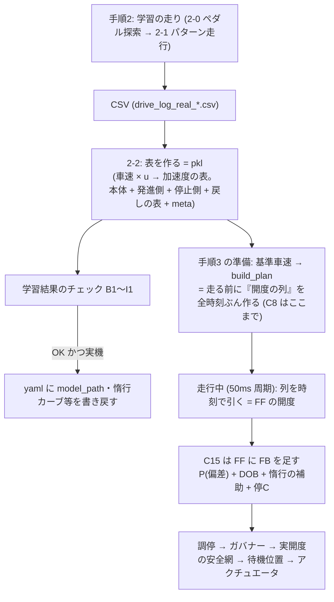
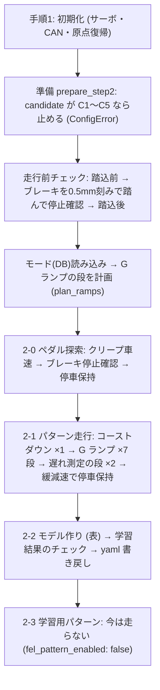
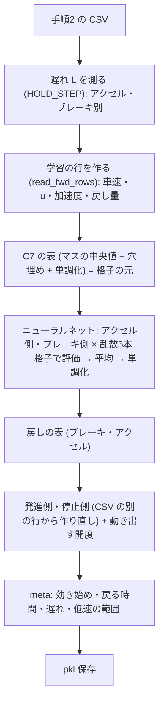
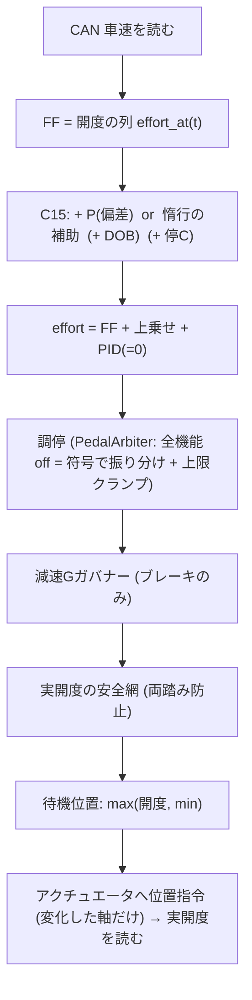

# tests/research の FF（フィードフォワード）制御の中身（段5 終了時点・2026-10-23）

段5（ProblemReport_20261001）を終えた時点の、手順2 の走り方・モデル（表）の作り方・手順3 の表の引き方・その他の FF の制御を、コードを読んで書いたもの。数値は段5-8 で採った pkl `fwd_model_20261023_072511.pkl`（手順2 `drive_log_real_20261023_151009.csv` から `--retrain`、除外 none）と本体 yaml の値。

- 場所の書き方は `ファイル:関数` または `ファイル:行`（行は 2026-10-23 時点）。ファイルは断りがなければ `tests/research/` 配下。
- 値は `config_testVehicle.yaml`（以下「yaml」）の今の値。config.py の既定と違うものは「yaml X ／ 既定 Y」と両方書く。
- 「推測」と書いたもの以外は、コード・yaml・pkl の中身で確かめた事実。
- yaml の `feedforward.candidate` は **C15**（`config_testVehicle.yaml:50`）、`model_path` は `results/models/fwd_model_20261023_072511.pkl`（段5-8 で採用）。段5 の比較は yaml のコピーで C8（FF のみ）にして走った。

---

## 0. 全体の見取り図

FF は「走る前に作る部分」と「走りながら足す部分」に分かれる。

- C8 = 「開度の列」だけ（FF のみ）。C10 = C8 + 偏差の P。C11 = C10 + DOB。C12 = C11 + 惰行の補助。C15 = C12 + 停A（開度の列を作るときに停車保持へ早く入る）+ 停C（停車まぎわの P の τ を変える）。クラスの継承は `ff_candidate.py:679`（ForwardMapFeedforward）〜`:982`（StopEndFeedforward）。
- 手順3 の `main.py:607 step3_mode_drive_ff` は、`mode_drive.prepare_mode_drive`（走行前チェックの前に pkl を読み、`fwd_plan.build_plan` で列を作る）→ `run_mode_drive`（50ms 周期）の順。

---

## 1. 用語の定義

### 1.1 開度と u

| 用語 | 定義 | 今の値・場所 |
|---|---|---|
| 開度 [%] | アクチュエータの位置。0% = 原点復帰位置（0 pulse）、100% = 9500 pulse。ペダルの踏み込み量そのものではなく、アクチュエータのストローク。 | `vehicle.py` `STROKE_LIMIT_PULSE`、`research_types.py:28 ACTUATOR_PULSE_MAX=9500`。yaml コメント（`config_testVehicle.yaml:16`） |
| min（待機位置） | 「ペダルに触れた位置」。使っていないペダルをここに置いて待たせる。u の原点でもある。手で測って書く。 | アクセル 4.2%、ブレーキ 4.2%（`vehicle.min_accel_opening_pct` / `min_brake_opening_pct`、yaml:31,33）。内部の名前は旧称の `*_deadband_pct` のまま、値は min（`vehicle.py` `feedforward_params`、pkl の meta `accel_deadband_pct` も 4.2） |
| u（min からの量） | 「効く開度」。アクセル: 実開度 − アクセル min（正）。ブレーキ: −(実開度 − ブレーキ min)（負）。どちらも min 以下なら 0。両方 min を超えている行は捨てる。 | `fwd_data.py:213 effective_opening`（不等号は「>」で許容幅なし）。G ランプ側の `u` は `pattern_loop._rp_u`（同じ定義の連続量） |
| effort | 開度の列の 1 要素。正 = アクセルの絶対開度、負 = ブレーキの絶対開度、0 = 両方 min（惰行）。accel なら `min + u`、brake なら `−(min + |u|)`。±100 でクリップ。 | `fwd_plan.py:360 build_plan`（effort 配列）、`:82 EFFORT_LIMIT_PCT` |
| 効き始め（onset） | ペダルを踏んでも加速度が変わらない「遊び」の終わりの開度。「惰行との差 d」が 0 から立ち上がる折れ目として求める。pkl の meta に min からの量で入る。 | 今の pkl: アクセル `accel_onset_u_pct`=5.75（絶対 9.95%）、ブレーキ `brake_onset_u_pct`=1.90（絶対 6.10%）。`play_onset.py:154 onset_from_series`、`pattern_drive.py:925 _attach_onsets`、走行中は `pattern_loop.py:2935 _update_onsets` |
| 動き出す開度（launch_breakaway） | 止まっている車のブレーキを離していって、車が動き出す開度（min からの量。負）。「ブレーキを離す向き」の値。 | 今の pkl: `launch_breakaway_u_pct` = −4.011（絶対 8.211%）。9 回の発進の中央値（−3.94〜−4.21）（`fwd_data.py:561 launch_breakaway`、RAMP_LAUNCH_RELEASE 区間から） |
| 停止確認開度 | 2-0 でブレーキを min から踏んでいって、平均車速が 0.02 km/h 未満になった開度（踏み込む向きの値）。 | `pedal_search.py:202 _search_brake`。yaml に直接は保存されない（G ランプの発進の開始位置に使う） |
| 停車保持の開度 | 停止確認開度 + 10%。停車中ブレーキをここに置く。yaml には min からの量 `stop_brake_offset_pct`（13.89）で持ち、走る直前に min を足す。 | 絶対 18.09%（= 4.2 + 13.89。`config.py:886 stop_brake_opening_pct`）。停止確認開度は 18.09 − 10 = 8.09%（計算）。動き出す開度 8.21% はそれより少し深い（踏む向きと離す向きでずれる） |
| 要る加速度（need） | 基準車速から決まる、「その時刻に車に出させたい加速度」[km/h/s]。基準車速の「t + 遅れ L」を中心にした幅 `need_window_s`（1.0 秒）の窓の最小二乗の傾き。 | `fwd_plan.py:124 window_slope_vec`。窓は 0.1 秒刻み 11 点（`NEED_STEP_S`） |
| 遅れ L | 開度を変えてから加速度が変わるまでの時間。ペダル別。手順2 の HOLD_STEP で測り pkl の meta に入る。 | アクセル 0.2485 s、ブレーキ 0.174 s、惰行はアクセルと同じ 0.2485 s（pkl meta `accel_lag_s` `brake_lag_s` `coast_lag_s`）。yaml `forward_map.accel_lag_s/brake_lag_s` は null（= pkl の値） |
| 戻し量（ブレーキ） | 直近 3 秒（その行を含む）の u の最小（最も深いブレーキ）からの戻り。u<0 の行だけ正（u − 最小）。 | `fwd_data.py:147 release_amount`、窓 `RELEASE_WINDOW_S`=3.0 |
| 戻し量（アクセル） | 直近 3 秒の u の最大からの戻り（最大 − u）。u>0 の行だけ正。 | `fwd_data.py accel_release_amount` |
| 踏み増し量（アクセル） | 直近 3 秒の max(u,0) の最小からの増え。今は使わない（`accel_push_input_enabled: false`）。 | `fwd_data.py accel_push_amount` |
| 低速 | 基準車速が pkl の meta `stop_max_speed_kmh`（今 7.5 km/h）未満。発進側・停止側の表が置き換えた車速の上限。 | `fwd_map.py:1035 attach_stop`。yaml に直接の設定名はない（pkl が決める） |
| 発進の途中 | 停車保持を抜けた最初の行から、計画が初めてアクセルを使う行（または停車保持に戻る行）の直前まで。アクセルが出なければ最後まで。 | `fwd_plan.py:760 _launch_midway` |
| 惰行 | 両ペダルを min に置く（effort = 0）。車は走行抵抗・エンジンブレーキ・クリープだけで動く。 | 計画の `FLAG_COAST` |
| クリープ | 両ペダルを min にして停車からゆっくり動き出す、車の自走。平衡で約 5.0 km/h。 | yaml `creep_speed_kmh`=5.0。クリープ加速のカーブ `creep_accel_*`（0.5 km/h で 2.22 → 5.0 km/h で 0.0 km/h/s）は 2-2 で測って yaml に書くが、手順3 の開度の列づくりでは使わない（チェック B3 が見るだけ。下記 3.8） |
| 停車速度 | 0.02 km/h。これ以下を「停車」とみなす（計画・パターン走行）。学習の行の「停車」は別で 0.5 km/h。 | `research_types.py:35 VEHICLE_STOP_SPEED_KMH`、`ff_model.py:75`、`fwd_data.py STOP_SPEED_KMH`=0.5 |
| 片足ルール | 片方のペダルが min を超えているとき、もう片方は min に置く。同時踏み防止。 | 計画の先置き・切り替えすき間（4.9〜4.10）、実開度の安全網（5.3） |
| G | 1G = 9.81 m/s² = 35.316 km/h/s。 | `research_types.py:46 G_TO_KMHS` |

### 1.2 表の呼び名

| 呼び名 | 意味 |
|---|---|
| 本体（accel_grid） | 車速の行 × u の格子 → 加速度。ニューラルネットを格子で評価して単調化したもの（3 章）。 |
| 発進側（launch_accel） | 低速の行だけ、発進（ブレーキを離す・クリープで進む・アクセルを踏み出す）の行から作り直した配列。 |
| 停止側（stop_accel） | 低速の行だけ、停止へ向かう減速の行から作り直した配列。 |
| 戻しの表（release） | 戻し量 {0（本体）,0.5,1,2,4,8}% ごとの配列。ブレーキの「戻している最中は効きが弱い」を表す。 |
| アクセルの戻しの表（accel_release） | 同じ構造のアクセル版。今のサーバー yaml は on（`accel_release_input_enabled: true`）。 |

---

## 2. 手順2 の走り方（`main --steps 2`）

入口: `main.py:369 step2_pattern_drive`。1 つの CSV（走行ログ。`drive_log_real_YYYYMMDD_HHMMSS.csv`、ファイル名は JST）に走行前チェックから停車保持までを 1 本で残す。

### 2.0 走行前チェック（2-0 の前）

- 順序（`main.py:948 run_steps`）: 設定検証（`validate_config_once`。yaml に無くて既定が効いているキーの一覧を表示。今は `learning.stop_brake_floor_*` の 3 つ）→ 手順1 → 手順2 の `prepare` → 走行前チェック → 手順2 本体。
- 走行前チェック（`pre_drive_check.py:100 run_pre_drive_check`、`next_step=2`）: 通信・サーボ・プロファイル・アクチュエータ位置の確認 → ブレーキを min から 0.5mm（0.53%）刻み・待ち 1.0 秒で踏み、平均車速が 0.02 km/h 未満になったら停止確認（車速が 0.3 km/h 以上下がっている間は踏み増さない。`brake_until_stopped :153`）→ 踏込後に車速 0 km/h を確認。UPS は `init_ups: false` / `pre_ups: false` で見ない。

### 2.1 2-0 ペダル探索（`pedal_search.py:241 run_pedal_search`）

何をどう測るか:

1. 両ペダルを min（4.2% / 4.2%）に置く。
2. **クリープ車速を測る**（`wait_creep_stable :154`）: 平均車速を 7 秒の窓で出し続け、窓平均の傾きが 0.020 km/h/s 未満・平均 1.0 km/h 以上・開始から 7 秒以上のとき確定。上限 90 秒。確定した平均 = クリープ車速（今 5.0 km/h）。
3. **停止確認開度を測る**（`_search_brake :202`）: ブレーキを min から 0.1mm（`brake_step_mm`。約 0.105%）ずつ踏み、1.0 秒待って平均車速を見る。平均車速が 0.02 km/h 未満になった位置が停止確認開度。直前の刻みで 0.3 km/h 以上下がっている間は踏み増さない。ブレーキの上限 47.3%（`max_brake_opening_pct`）まで踏んで止まらなければエラー。
4. **停車保持にする**: 停止確認開度 + 10%（`stop_hold_margin_pct`）まで 0.5mm 刻み・0.2 秒待ちで踏み、そのまま保持。
5. 実機（`hw.is_real`）のときだけ yaml に書く（`PedalSearchResult.config_updates :87`）: `feedforward.stop_brake_offset_pct`（停車保持 − ブレーキ min。13.89）と `feedforward.creep_speed_kmh`（5.0）。スタブでは書かない。
   - 注意: この書き込みは 2-2 のチェックより前。チェックが NG（終了コード 8）になっても 2-0 の 2 項目はすでに yaml に書かれている（`main.py` の NG メッセージは「yaml は書き換えていません」と出すが、それは 2-2 の書き戻しのこと）。

### 2.2 2-1 パターン走行（`pattern_drive.py:617 run_pattern_drive` → `pattern_loop.py` の `PatternLoop`）

パターン列（`pattern_drive.py:470 build_patterns`、`with_lag=True`）:

| 順 | パターン | 本数 |
|---|---|---|
| 1 | コーストダウン（COAST_DOWN） | `COAST_DOWN_COUNT`=1（`learning_patterns.py:17`） |
| 2 | G ランプ（GRampPattern）: 弱い G の段から順に | 7 段 × `ramp_max_passes`=1（yaml 1 ／ 既定 2） |
| 3 | 遅れの測定の段（G ランプの `lag_step=True`）: 狙いの G は `ramp_lag_approach_g`=0.125、上端は `ramp_lag_speeds_kmh`=[30,60] | 2 本 |
| 4 | 走行後の緩減速 → 停車保持（`stop_decel.py:65 decelerate_to_stop`） | 1 回 |

各パターンの間は必ず DRIVE_BRAKE で停車してから次へ進む（`_finish_pattern`、`pattern_loop.py:3196`）。打ち切り: 全体 `learning.timeout_s`=7200 s（既定 3600）。

#### 2.2.1 コーストダウン

- 加速（`DRIVE_ACCEL`。`_step_coast_accel :1361`）: アクセルを「min−1%」（`coast_accel_approach_margin_pct`）まで 1.5 秒で上げて遊びの手前まで行き、以降は踏む速さ [%/s] = 100 ×（目標 G − 今の G）。目標 G は `decel_stop.target_decel_g`=0.2G、±0.02G（`press_margin_g`）は保持、窓 1.0 秒の傾きで G を出す。開度の上限は `COAST_DOWN_ACCEL_PCT`=70% を機構上限 61% で頭打ち。踏み増す向きは「実開度 + 2%」（`ramp_actuator_lag_tol_pct`）までに制限。
- 加速の終わり: 車速 ≥ 上端 − 加速度 × 1.2 秒（`overspeed_lead_s`）、または加速 60 秒（`accel_full_range_timeout_s`）。上端 = モードの最高車速 + 5 = **136.3 km/h**（`ramp_planner.top_speed_cap_kmh`。ただし車両最高速 150 × 0.98 = 147 より低いのでこちら）。
- 惰行（`COAST`。`_advance_coast :3046`）: 両ペダル 0%（完全解放）。1.5 秒（`coast_measure_delay_s`）後から減速を惰行カーブの点として貯める。終わり: 車速 ≤ クリープ車速（5.0）、または 車速 ≤ クリープ車速+1.0 で傾きが 0.1 km/h/s 未満の状態が 2 秒続いたとき、または 300 秒（`coast_timeout_s`。既定 90）。
- 停車復帰（`DRIVE_BRAKE`。`_step_gprop_brake :3006`）: クリープ車速+1.0 km/h（6.0）より上は「G 比例ブレーキ」（0.5mm 刻み・1.0 秒ごとに窓 1 秒の減速 G を見て、目標 0.2G − 0.02G 未満なら踏み増し、0.3G 超なら戻す。上限は停車保持開度）。6.0 km/h 以下は今の開度から停車保持開度まで一定の速さ（0.526%/s）で踏み上げ、停車して届いたら次へ。
- 何が貯まるか: 惰行の減速の点（`glimit.add_coast`）→ 2-2 の惰行カーブ・効き始めの計算に使う。加速・ブレーキの (開度, 加速度) の点 → 上限 G の予測マップ `GLimitMap`（`g_limit.py`）。

#### 2.2.2 G ランプ（`GRampPattern`）

1 本 = 停車から「狙いの G」で上端の車速まで加速（RAMP_UP）→ 上端で保持（RAMP_HOLD）→ 同じ G で減速（RAMP_DOWN）→ 停止。開度は固定値を持たず、**基準車速に実車速を追従させる**形で u を動かす（`_ramp_control :1850`）。

**段と上端の車速**（`ramp_planner.py:425 plan_ramps`。`python -m tests.research.ramp_planner` で今の yaml のまま表示した結果）:

| 狙いの G | 上端 [km/h] | モード秒 加速/減速 | 1 本の見込み [s] | 周回 | 途中の定速保持（km/h） | 下りの戻し（km/h。`ramp_release_enabled` が true のときだけ走る） |
|---|---|---|---|---|---|---|
| 0.02 | 136.3 | 358 / 319 | 676 | 1 | 15,25,35,45,55,65,75,85,95,110,130（上り・下りの各 11 回） | なし |
| 0.045 | 130 | 211 / 183 | 358 | 1 | 15,25,45,55,65,75,85,95,110（上りだけ 9 回） | 15,25,35,45,65,75,85,110（8 回） |
| 0.08 | 130 | 147 / 140 | 189 | 1 | 15,35,65,85（上りだけ） | 15,35,65（3 回） |
| 0.125 | 120 | 74 / 67 | 119 | 1 | 15,45（上りだけ） | 25,65（2 回） |
| 0.175 | 70 | 31 / 64 | 68 | 1 | 15（上りだけ） | 25（1 回） |
| 0.25 | 50 | 20 / 20 | 37 | 1 | なし | なし |
| 0.35 | 60 * | 6 / 2 | 36 | 1 | なし | なし |

合計見込み 1483 秒（枠 `ramp_time_budget_s`=1600。既定 1500）。* は「最小の上端」で引き上げた値。

- 狙いの G の段: `learning.ramp_g_levels` = [0.02, 0.045, 0.08, 0.125, 0.175, 0.25, 0.35]（データ由来: WLTP+US06 の 1 秒ごとの加速度の秒数の帯）。段 i の帯は `|a|` が [下端, 上端)、下端は隣り合う段の中点、最下は levels[0]/2（`ramp_planner.py:132 level_lower_edges`）。
- 上端の車速: その段の帯で、加速側か減速側のモード秒数が `ramp_mode_min_s`=2.0 秒以上ある車速帯（10 km/h 幅）のうち最も高い帯の上端。上限は 136.3（モード 09_US06+WLTP の最高車速 131.3 + `ramp_top_margin_kmh`=5.0）。
- 最小の上端（強い G の段で基準が狙いの G にいる時間を確保）: `min_top_kmh :409` = ceil（立ち上げで進む車速 + G×35.316×(`ramp_min_at_g_s`3.25 + `ramp_turn_time_s`2.0 ÷ 2) を 10 に切り上げ）。0.35G は 59.6 → 60。
- 「周回」は `ramp_max_passes`=1 なので 1 周のみ（枠が余っても 2 周目を足さない）。
- 戻しの欄は、今の yaml（`ramp_release_enabled: true`、段5-8 で採用）で実際に走る。false にすると RAMP_RELEASE に入らない（`pattern_loop.py:2527 _ramp_release_try_enter` が最初に false で戻る）が、planner の見込みには戻しの 14 回ぶん（約 105 秒）が入ったまま。`151009` の実測: 0.045G 7 回 43.5 秒・0.08G 3 回 18.9 秒・0.125G 2 回 13.2 秒・0.175G 1 回 6.8 秒。

**G ランプ中の開度の決め方**（`pattern_loop.py:1850 _ramp_control`、50ms 周期）:

1. **基準車速 v_ref を自分で作る**: 段ごとに 0 km/h から始まり 0 km/h で終わる 1 本の線。`v_ref += g_ref × 35.316 × dt`。狙いの加速度 g_ref（G）は `_ramp_gref :1673`:
   - 発進: 動き出し（実車速が 0.02 km/h を初めて超えた周期）から `ramp_launch_time_s`=1.0 秒で g_min（= min(`ramp_edge_g`0.05, G)）→ +G。動き出す前は +G のまま（基準を先に進めて偏差でブレーキを離す）。
   - 上端の手前で +G → 0（`ramp_turn_time_s`=2.0 秒）、上端で `ramp_hold_time_s`=7.0 秒保持、0 → −G（2.0 秒）。
   - 停止: −max(g_min, G×min(1,√(v_ref ÷ v_stop)))、v_stop = G×35.316×`ramp_stop_time_s`(1.0)÷2。
2. **偏差** e = v_ref − 実車速。不感帯 `ramp_dev_deadband_kmh`=0.5 km/h: e′ = |e|≤0.5 なら 0、外側は不感帯を引いた量（境目で連続）。基準が 0 km/h に着いた後の減速と、発進の動き出しの置き直しの前は不感帯なし（`_ramp_deadband_kmh :1799`）。
3. **増分形の PI**: Δu = Kp × (e′ − e′_前) + (Kp ÷ Ti) × e′ × dt + 寄せ。
   - Kp = 1 ÷（感度 × T）、T = `ramp_settle_time_s`=2.0 秒、Ti = 4 × T（`RAMP_TI_RATIO`）。アクセル・ブレーキ共通。
   - **感度** = 「開度 1% あたりの加速度の変化 [km/h/s per %]」。そのペダルについて **走行中に貯めた (開度, 加速度) の点**（`GLimitMap`。車速 10 km/h 帯ごと・1 帯 40 点まで・1 秒に 1 点）から、今の開度の ±5% の点（3 点以上）の最小二乗の傾きと帯全体の傾きを作り、大きい方（小さく見積もると危険側に開度を速く動かすため）。点が近すぎて傾きが雑音になる候補（傾き × 点の開度幅 < 不感帯 ÷ T = 0.25）は外す。作れなければ隣の帯（`g_limit.py:282 sensitivity_kmhs_per_pct`）。
   - 感度が取れない間は Kp・Ki を使わず、e′ の向きにアクチュエータの最小刻み 1 個（約 0.0105%）/周期。基準が車より cap（= G×35.316×T）以上先に行かないよう引き戻す。
   - 貯める点: 実開度の「遅れ 0.6 秒（`gov_lead_s`）ずらした窓の平均」と、窓 1 秒の実測加速度の対。自分が min+0.3% より上で反対側が min+0.3% 以下のときだけ。1 秒に 1 点（`_step_ramp :2146`）。
4. **片側調整**（`ramp_one_sided: true`）: RAMP_UP は車が基準より遅いときだけ u を増やし、RAMP_DOWN は車が基準より速いときだけ u を減らす（`_ramp_one_sided_dir :1742`）。行き過ぎた周期は開度を動かさず v_ref を実車速に合わせる。実測 G が段の上端（隣の強い段との中間: 0.0325, 0.0625, 0.1025, 0.15, 0.2125, 0.30。最強の段はなし）を超えたら Kp × (実測 − 狙い) × dt で逆方向へ戻す。
5. **表の寄せ**（表は 1 回引いて決めた時間で等速に足すだけ。毎周期は足さない）:
   - 発進でアクセルに移った周期: その車速で段の G が出る開度（`_ramp_estimate_u`）との差を、(G − g_min) ÷ `ramp_launch_g_rate_gps`(0.15) 秒（最短 `ramp_launch_blend_min_s`0.5 秒）で（増やす向きだけ）。
   - 保持の頭（`_ramp_switch_hold :2487`）: その車速で 0G のアクセル開度へ 2 秒で。
   - 減速の頭（`_ramp_switch_down :2849`）: 惰行より緩い狙いはアクセル側の値へ 2 秒で、それ以外でアクセル u>0 なら 0 へ、続けてブレーキ側の見積もり（自分の車速帯で内挿できるときだけ）へ。
6. **ガバナー**（`_next_gov_cap :3285`）: 上限 = `vehicle.max_decel_g`0.45 × 0.98 = 約 15.6 km/h/s。見込み（今 + 増える速さ × 0.6 秒）が上限の `gov_soft_frac`=0.95 以上で踏み増しを止め、上限以上で 2%/周期（0.1 秒周期ぶんを換算）ずつ下げる。解除は上限の 0.7 倍未満で 0.5%/0.1 秒ずつ戻す。
7. **アクチュエータが遅れている間**（|指令 − 実開度|>2%、さらに離れる向き）は基準を実車速側へ戻す（`_ramp_actuator_lagging :1819`）。
8. **u の範囲**（`_ramp_u_limits :1447`）: RAMP_UP でアクセルに入った後は下限 0（ブレーキへ戻らない）。RAMP_DOWN でブレーキに入った後（ラッチ）は上限 0（アクセルへ戻らない）。ラッチ後のブレーキは `min − u`（0% へ飛ばさない）。
9. **発進のゆっくり離し**（`_ramp_launch_release_step :1648`、段2o-10）: ① 停車保持 → 「停止確認開度 + 2%（`ramp_launch_release_margin_pct`）」を 2.0 %/s（`fast_rate`）で、② そこから 0.25 %/s と 0.5 %/s（`ramp_launch_slow_rates_pctps`。発進ごとに交互）で、車速が `creep_launch_min_speed_kmh`（1.0 km/h）に達するまで離す。上限は (停止確認+2−min)÷slow+5 秒。CSV の phase は `RAMP_LAUNCH_RELEASE`。この間は偏差の項・基準・点の貯めを使わない。**動き出す開度の測定用**。

**定速の保持（RAMP_CRUISE。`_ramp_cruise_try_enter :2367`）**: 上の表の「途中の定速保持」の車速に着いたら（上り: 実車速 ≥ 保持点 − max(0,加速度)×1.0 秒、下り: 実車速 ≤ 保持点 + max(0,−加速度)×1.0 秒）、g_ref を入った時点の実測 → 0 に 2 秒で変えて定速を保つ。偏差の項は両方向で使う。実測加速度が ±0.005G（`ramp_cruise_band_g`）以内だった時間の合計が **5 秒**（`ramp_cruise_hold_s`。yaml 5.0 ／ 既定 7.0）で出る。入ってから 2 + 15 秒（`ramp_cruise_timeout_s`）で打ち切り。保持の車速は 100 km/h までは 10 km/h 帯の中心、それより上は 20 km/h 刻み（`ramp_cruise_fine_max_kmh` `ramp_cruise_coarse_step_kmh`）。クリープ車速+5 = 10 km/h 未満は保持しない。

**戻し（RAMP_RELEASE。`_ramp_release_try_enter :2527`）**: 下りでブレーキを踏んでいる山から離して惰行まで戻し、−G へ踏み直す。今の yaml は **on**（`ramp_release_enabled: true`、段5-8 で採用）: u を山 u_peak → `ramp_release_fracs`=[0.5, 0.0] 倍へ、1.0 秒（`ramp_release_move_s`）で直線に離し、1.5 秒・2.0 秒（`ramp_release_hold_s`）保持。ブレーキの効き始め u_on がある場合は割合 f の目標を `−u_on + f×(u_peak+u_on)`（f=0 は待機位置）にして遊びで空振りしない（`_ramp_release_u :2643`）。この間は偏差の項・点の貯めを使わない。

**停止前の戻し B-1（`stop_release_enabled`。今の yaml は on、段5-8 で採用）**（`_stop_release_try_enter :2570`）: 各 G ランプの下りで実車速が 7.5 km/h（`stop_release_start_kmh`）を切ったら、ブレーキを山（直近 3 秒の最深）の 0.25 倍・0.5 倍（段ごとに交互。`stop_release_fracs`）だけ 2.0 %/s で戻し、そのまま停車まで保つ。入らない段: 目標 G が 0.2G（`stop_release_max_g`）超、ブレーキのラッチ前、u≥0。逃げ道: 加速度 ≥ −0.1 km/h/s（`stop_release_escape_decel_kmhs`）が 0.5 秒続いたら停車復帰へ。安全網 30 秒。CSV の phase は `RAMP_STOP_RELEASE`。

**遅れの測定（HOLD_STEP。遅れ測定の段 2 本）**: 上端（30, 60 km/h）の保持（RAMP_HOLD。実測加速度が ±0.005G 以内の時間の合計が 5 秒）の後、開度を固定で 2.5 秒（`ramp_lag_step_hold_s`）ずつ順に（`_ramp_step_targets :2710`）: アクセル踏み増し（u_hold + Δa）→ 戻し（u_hold）→ 0 → ブレーキ（効き始め u_on があれば −u_on → −(u_on+Δb) → −u_on → 0、なければ −Δb → 0）。Δa は「ステップの加速度 `ramp_lag_step_g`=0.05G」が出る開度の差（表と感度の小さい方）。Δb は惰行の減速 + 0.05G を出す開度 − min。アクセルの起点が効き始めより浅いと警告を出して数える。

**G ランプ 1 本の後**: 結果（上り・保持・下りの秒、実測 G の中央値、最高車速、その時点の効き始めの値）を記録し（`_ramp_record_result :2893`）、**毎本ごとに効き始めを求め直す**（`_update_onsets :2935`）。

### 2.3 2-2 モデル作り → チェック → 書き戻し

入口: `main.py:369` → `pattern_drive.py:1411 build_ff_model`。流れは 3 章。順序（`build_ff_model` の docstring）: 遅れを測る → 表を作る（C7 → C8）→ 惰行カーブ・クリープカーブ・ペダルゲインを推定 → **チェック（C2 以外）→ OK なら yaml へ書く → C2（yaml を読み直す）**。

#### 学習結果のチェック（`step2_check.py`。しきい値は `THRESHOLDS :46`）

| 項目 | 何を見るか | NG になるしきい値 |
|---|---|---|
| B1 学習データでの外れ（`check_fit :183`） | 学習データでの C8 の MAE（実測の加速度 − 表の加速度）と、C7（データから直接作った表）との比。乱数ごとの MAE（meta `seed_mae`）の外れ | MAE の比（C8÷C7）> 1.0。乱数ごとの MAE が「他の乱数の中央値 × 1.2（`SEED_OUTLIER_RATIO`）」を超えた乱数が 1 つでもあれば NG（その場合だけ 1 回、外れた乱数を +100 した別の乱数に替えて学習し直す。`pattern_drive.py:1373-1395`） |
| B3 惰行・クリープ（`check_coast :240`） | 表の u=0 の加速度と yaml の惰行カーブの差（車速 [クリープ+5, モード最高] の点の最大） | 差の最大 > `forward_map.coast_band_kmhs`（0.25）。yaml のクリープ加速度に正があるのに発進側の表が無ければ NG（停止側の有無は表示のみ） |
| B4 遅れ（`check_lags :301`） | pkl の meta の遅れと、測れた遅れ（測れなければ既定値 0.05）の差 | 差 > 0.005 s（アクセル・ブレーキ各） |
| B5 効き始め（`check_onsets :375`） | meta の効き始めと、①走行中の最後の値（RampResult）②yaml の惰行カーブで CSV から計算し直した値との差（絶対開度） | 差 > **2%**（`B5_TOL_PCT`。2026-10-23 に 0.5% から変更）。meta にキーが無いのに①②が求まっていれば inf で NG |
| B6 戻る時間（`check_returns :337`） | meta の `*_return_delay_s` `*_return_rate_pct_s` と CSV から計算し直した値の差 | 遅れ 1e-6 s、速さ 1e-4 %/s 超 |
| C1 yaml の停車保持開度（`check_measured_in_yaml :444`） | 実機のみ。yaml を読み直した停車保持開度と 2-0 の実測の差 | 0.01% 超 |
| C2 model_path（`check_model_path :471`） | yaml が保存した pkl を指すか・読めるか・kind が candidate と合うか（C8/C10〜C15 は model）。**yaml を書いた後**に判定 | パス違い、読めない、kind 違い（kind_mismatch は記録のみ） |
| D1 手順3 の開度の列（`check_plan :511`） | 手順3 と同じ引数・同じ表（A2 の床・FEL・ぼかし・C15 の停A 込み。`mode_drive.forward_map_plan_args` を共有）で WLTP の開度の列を作って、範囲外・穴埋めの秒数、NaN、先置きの超過量、切り替えすき間の不足を数える | NaN > 0。先置き超過 > 1e-9%。すき間不足の残り > 0。範囲外秒 ÷ モード秒 > 0.10、穴埋め秒 ÷ モード秒 > 0.32 |
| I1 表の作り方のお知らせ（`check_table_extras :597`） | 発進・停止側の開度の元、停止側の戻しの層、アクセルの戻し・踏み増しの入力と秒数・頭打ち、ブレーキの戻し 7.5〜20 km/h の秒数 | なし（NG にしない） |

(F1 FEL の埋まり方は 2-3 を走らないので出ない。`check_fel_coverage :774`)

- スタブ（hw != real）は表示だけで止めない。実機で NG があれば `Step2CheckError` → 終了コード 8、yaml の 2-2 の書き戻しはしない（pkl は残る）。

#### yaml への書き戻し（実機のみ。`pattern_drive.py` の `build_ff_model` 末尾）

書く: `feedforward.model_path`（作った pkl）、`FF_PARAM_KEYS`（`pattern_drive.py:191`）のうち `MEASURED_KEYS`（停車保持・クリープ車速。2-0 が書く）を除く: `creep_rate_kmhs`、`creep_accel_speeds_kmh` `creep_accel_kmhs`（クリープ加速カーブ）、`engine_brake_decel_kmhs`、`coast_decel_speeds_kmh` `coast_decel_kmhs`（惰行カーブ）、`pedal_gain_speeds_kmh` `accel_gain_kmhs_per_pct` `brake_gain_kmhs_per_pct`（ペダルゲイン）。コメントは保持して値の行だけ置換（`cfg.save`）。**書かない**: `candidate`、`vehicle.min_*`、`forward_map.*`、`coast_band_kmhs`（人が決める値）。

### 2.4 2-3 と所要時間

- 2-3（学習用パターン = FEL の補正表の学習走行）: yaml `learning.fel_pattern_enabled: false`（既定も false。2026-10-23 のユーザー決定で今後使わない）。false なら 2-2 で終わる（`main.py:432`）。`fel.enabled: false` も同じ（補正表は付けない）。
- 所要時間の内訳（コードの見込み + 記録の実測。実測は 5-8 の `151009` = 28.5 分が最新で、今の本体 yaml と同じ走り方）:

  | 区間 | 秒数 | 根拠 |
  |---|---|---|
  | 走行前チェック | 数十秒〜（ブレーキの刻み踏みで変わる） | 推測 |
  | 2-0 ペダル探索 | 約 196 | ProblemReport 2k の計画値（前の車の実測。今の 2-0 は刻みが違うので推測） |
  | コーストダウン | 約 93 | 同上 |
  | G ランプ 7 段（planner の見込み） | 1483（戻し 14 回ぶんの約 105 秒を含む） | `python -m tests.research.ramp_planner` |
  | 遅れ測定の段 2 本 | 約 40 + 53（`estimate_s` の式で計算。保持は 5 秒ベースなので近似） | 計算 |
  | 緩減速・停車保持 | 数十秒 | 推測 |
  | 2-2 モデル作り（5 乱数・2 並列の学習） | 100〜180 秒 | 記録（10/06 の 102 秒、10/13 の 178 秒） |

  合計は 28〜32 分（記録: `151009` 28.5 分、2-3 ありで約 43 分）。

### 2.5 今の yaml で on/off を切り替えるもの

| 設定 | yaml | config.py 既定 | 切ると |
|---|---|---|---|
| `learning.ramp_release_enabled` | true | true | false で下りの戻し（RAMP_RELEASE）に入らない。planner の車速・見込みは変わらない |
| `learning.stop_release_enabled` | true | true | false で停止前の戻し B-1 を走らない |
| `learning.stop_approach_exclusion` | none | none | depth / window で停車まぎわ除外の外し方が変わる（3.1） |
| `learning.fel_pattern_enabled` | false | false | true で 2-3 を走る |
| `learning.accel_release_input_enabled` | true | false | アクセルの戻し量をニューラルネットの 3 つ目の入力にし、アクセルの戻しの表を作る（5-7a で採用） |
| `learning.accel_push_input_enabled` | false | false | アクセルの踏み増し量を入力に足す（5-7b で不採用） |
| `learning.stop_release_layer_enabled` | false | false | 停止側の戻しの層を作る |
| `learning.launch_accel_side_source` | measured | extrapolate | 発進側のアクセル側の作り方（5-3 で採用） |
| `learning.side_table_accel_window_s` | 1.0 | 0.5 | 発進側・停止側の表の加速度の窓（5-3 で採用） |
| `learning.launch_rows_to_stop_max` | false | false | 発進側を停止側と同じ 7.5 km/h まで広げる（5-4 不採用） |
| `learning.side_row_speed_rep` | grid | grid | 発進側・停止側の行の代表車速をデータ側に（5-4 不採用） |
| `learning.side_table_opening_source` | actual | actual | 発進・停止側の表を実開度（actual）か指令（cmd）で作る |
| `learning.ramp_one_sided` | true | true | G ランプを片側調整にする |
| `learning.ramp_max_passes` | 1 | 2 | 1 段あたりの周回数 |

---

## 3. モデル（表）の作り方（2-2）

流れ: `pattern_drive.py:1184 _build_forward_model`。**C7 の表を先に作り、その格子と設定の上にニューラルネット（C8）を学習して評価した表**を作り、低速用の表・戻しの表・meta を付けて pkl に保存する。pkl は `fwd_model_<UTC 日時>.pkl`（名前は UTC。CSV は JST）。

### 3.1 学習に使う行・外す行（`fwd_data.py:253 read_fwd_rows`）

**使う CSV の区間**: `DEFAULT_SECTIONS` = PATTERN_DRIVE と MODE_DRIVE。手順2 の CSV ではパターン走行（PATTERN_DRIVE）の行だけが本体の学習に入る（走行前チェック・ペダル探索・緩減速の区間は本体には入らない。発進・停止側の表には別に使う: 3.6）。

**u の元になる開度**: 本体は最終指令の開度 `*_cmd_pct`（`opening_source: cmd`。pkl の meta `opening_source`='cmd'）。発進・停止側の表だけ実開度 `actual`（`side_table_opening_source: actual`）。

**行ごとに捨てる理由と数え方**（`DROP_*`）:

| 捨てる行 | 条件 |
|---|---|
| 実開度が空 / 実車速が空 | 列が空 |
| 停車 | 実車速 < 0.5 km/h（`STOP_SPEED_KMH`。発進側の表を作るときは `keep_stopped=True` で残す） |
| 減速Gガバナー作動 | CSV の `governor_active` が真 |
| 指令と実開度がずれた | アクセルかブレーキのどちらかで |指令 − 実開度| > 2%（`DEFAULT_ACTUATOR_LAG_TOL_PCT`）。切り替えや大きな動きの途中が間接的に外れる |
| 両ペダルが min 超え | アクセルとブレーキが両方 min を超える行 |
| 加速度の窓が取れない | セグメント（section が同じで行間 0.5 秒未満の連続区間）の端で窓がない行 |

「切り替えの前後」を明示的に外す処理は、`fwd_data.py` `fwd_cv.py` `fwd_final.py` の中には見つからなかった（上の「指令と実開度がずれた」と「両ペダル」が間接的に効く）。

**加速度の作り方**: 実車速の、時刻 t + 遅れ L を中心にした幅 `accel_window_s`=1.0 秒（pkl meta `accel_window_s`）の最小二乗の傾き（`ff_bias.window_slope`）。L は u>0 の行が accel_lag（0.23）、u<0 が brake_lag（0.1985）、u=0 が coast_lag（0.23）。窓はセグメントの中だけ。つまり「時刻 t の車速 × 時刻 t の u → t+L の加速度」。

**遅れ L の決め方**: 既定は 0.05 秒（`DEFAULT_ACCEL_LAG_S`）。手順2 の HOLD_STEP から測れたペダルはその値（`pattern_drive.py:838 measure_pedal_lags` → `pedal_lag.py:355 estimate_hold_step_lag`）。「指令の 50% 点 → 加速度の 50% 点」の時間差のペダル別中央値（踏み増し・戻しをまとめる）。採る条件: 件数 ≥ 2（`LAG_STEP_MIN_STEPS`）、0 < L ≤ 2.0 s、指令の変化 ≥ 1%、ステップ長 ≥ 2.2 s、min 発着のステップは除く。

**戻し量・踏み増し量**: 行を捨てる前の全時系列で計算してから行に付ける（3 秒窓の山を落とさないため）。

**学習から外す行**（`fwd_cv.py:319 fit_one_info`）:

- ブレーキ側から「発進の区間」の行（`launch_row`）を外す（`brake_exclude_launch: True`。`fwd_data.py:491 launch_mask`: 停車の行から始まり、u≤0 かつ加速度 ≥ −0.05 km/h/s が途切れず続く間）。発進は別の表（発進側）が受け持つ。
- **停車まぎわ除外**（`learning.stop_approach_exclusion`。yaml・既定とも `none`＝外さない。段5-8 で採用）:
  - depth（段2i〜5-8 前まで）: 実車速 < 5 km/h かつ u ≤ −8% の行を外す（`fwd_cv.py:235 stop_approach_mask`、`STOP_APPROACH_SPEED_KMH`=5.0、`STOP_APPROACH_U_PCT`=−8.0）。両側の学習から。
  - window: 加速度の窓が「停車の瞬間」（実車速が 0.5 km/h 未満になった最初の点）の ±0.5 秒にかかる行だけ外す。
  - none（今）: 外さない。停止前の戻し B-1 の行を学習に入れるため（5-8 の決定 5）。今の pkl の meta `stop_approach_exclusion`='none'。
- 停車保持の行そのもの: 実車速 < 0.5 km/h なので上の「停車」で外れている。

**重み**: 行の重みなし（`time_weight: False`）。

### 3.2 ニューラルネット（`fwd_torch.py:144 fit_side`、`fwd_final.py:130 build_final_table`）

- **2 本**: アクセル側（u ≥ 0 の行。惰行 u=0 も入る）とブレーキ側（u ≤ 0 の行。惰行も入る。`coast_from: mean`）。
- **入力**: アクセル側 = (車速, u, アクセルの戻し量)（3 つ。`accel_release_input_enabled: true`）。踏み増し量は入れない。ブレーキ側 = (車速, u, ブレーキの戻し量)（3 つ）。入力は標準化。
- **層**: 隠れ層 2 つ × 各 50 個、活性化 relu、出力 1（`pattern_drive.py:175 FORWARD_HIDDEN=(50,50)`、`FORWARD_ACTIVATION='relu'`）。
- **目的変数**: 加速度（標準化して学習、予測で戻す）。
- **損失**: 絶対誤差（L1）+ L2 正則化（`ALPHA_L2`=1e-4 × 0.5 × |W|² ÷ バッチ）。
- **最適化**: Adam 学習率 1e-3、バッチ 200、検証 10%（行の無作為抜き）、10 回改善なし（改善幅 1e-4 未満）で打ち切って最良の重みに戻す、最大 500 エポック（`MAX_ITER`）。
- **乱数**: 5 本（`fwd_final.DEFAULT_SEEDS = (0,1,2,3,4)`）。乱数ごとに学習 → 評価した配列を平均 → **1 回だけ**行ごとに単調化（`fwd_model.py:386 grid_from_raw`）。
- **並列**: `FORWARD_WORKERS`=2（spawn の別プロセス。各プロセスの torch は 1 スレッド）。
- 乱数ごとの学習データでの MAE を meta `seed_mae` に残す（今の pkl: 0.183, 0.182, 0.183, 0.185, 0.187）。

### 3.3 本体の表の格子（`fwd_map.py`）

- **車速の行**: 境界 0, 2.5, 5, …, 15（2.5 km/h 刻み）、20, 25, …（5 km/h 刻み）。今の pkl は 31 行、境界の最後 140 km/h（`fwd_data.py:689 make_speed_edges`）。行の代表車速は行の中心。
- **u の格子**: C7 は 2% のマス（u の範囲はデータで決まる。0 は惰行だけの独立の 1 点、u>0 は ((k−1)×幅, k×幅]、u<0 は [−|k|×幅, −(|k|−1)×幅)）。C8 は同じ範囲を 0.5% 刻みに細かくした格子（`FORWARD_TABLE_U_STEP_PCT`=0.5、`fwd_map.py:734 refine_u_grid`）。今の pkl は 157 点（−19.75〜+57.75、0 を含む）。
- **引き方**: 車速方向は行の代表車速の間、u 方向は格子点の間を直線補間、端は止める（`fwd_map.py:560 grid_accel`）。
- **C7 の表の作り方**（`fwd_map.py:1465 build_table`。C8 の格子・穴の定義の元）: マスごとに加速度の中央値と秒数 → 秒数 ≥ 1.0 秒（`min_s`）が実測点 → 実測が 2 点以上ある行で、両隣の実測点の間は直線で穴埋め（種類=穴埋め）、実測範囲の外は端の値で止める（種類=範囲外）→ 実測の範囲内だけ行ごとに IsotonicRegression（u に対して非減少）、重みは実測=秒数・穴埋め=0.1。実測が 2 点未満の行は最も近い行をコピーして全点を範囲外にする。
- **点の種類 POINT_***: 実測=0・穴埋め=1・範囲外=2（C8 でも C7 の種類を写す）。
- **単調化**: u に対して加速度が減らないよう行ごとに IsotonicRegression（重み一様）で 1 回（C8）。
- **惰行の加速度 `coast_accel(v)`**: 本体の u=0 の点（`fwd_map.py:514`）。u=0 の格子点はニューラルネット 2 式の平均（`coast_from: mean`、`fwd_model.py:289 raw_grid`）。低速では停止側の表の u=0（`dir` 規則）。
- **頭打ち・穴埋め**: 上記の端止め（範囲外）と穴埋め。Guard として `accel`/`invert` は戻し量・踏み増し量を meta の `*_max_pct` で頭打ちにする。

### 3.4 ブレーキの戻しの表（release）

- 戻し量 {0.5, 1, 2, 4, 8}%（`RELEASE_GRID_PCT`）ごとに、ブレーキ側ネットの戻し量入力にその値を入れて格子で評価した配列を作り（`fwd_model.py raw_release_slices`）、乱数平均 → 行ごとに単調化 → `attach_release`（`fwd_map.py:1267`）で付ける。戻し量 0 は本体。
- 作る条件: 学習のブレーキ行（u<0。発進の区間・停車まぎわ除外の行を除く）のうち戻し量 ≥ 0.3% の行の合計秒数が 10 秒以上。meta `release_max_pct` = ブレーキの行の戻し量の 95% 分位。引くときは戻し量を `min(release_max_pct, 8)` で頭打ち、節の間は直線補間（`ForwardTable._release_nodes`）。
- 今の pkl: 戻しの行 90.1 秒、`release_max_pct`=2.568%（5-8 の前の pkl `232500` は 46.2 秒・0.952% で、1% を超える戻しは表が頭打ちだった。これが 5-8 の動機）。7.5〜20 km/h の戻しの行は 18.3 秒（前は 3.0 秒）。

### 3.5 アクセルの戻しの表（accel_release）

- 同じ構造のアクセル版（`fwd_map.py:1315 attach_accel_release`）。アクセルの行（u>0。停車まぎわ除外は depth ではアクセルの行は外れない）の、アクセルの戻し量 ≥ 0.3% の行が 10 秒以上で付く。meta `accel_release_max_pct`。今の pkl: 339.1 秒、頭打ち 7.40%。
- 計画の解き直し（4.8）と DOB の予測がこの表を引く。

### 3.6 発進側・停止側の表（`pattern_drive.py:1006 _attach_low_speed_tables`、`fwd_map.py:778 _side_arrays`）

低速の車速の行（代表車速 ≤ クリープ車速 5.0 + 2.5 = 7.5 km/h の行）だけ、本体とは別の行から 0.25% のマス（`SIDE_U_STEP_PCT`）で作り直す。

- **発進側に使う行**: PATTERN_DRIVE の「発進の区間」の行、PEDAL_SEARCH/CREEP_WAIT（クリープ待ち）、PATTERN_DRIVE/RAMP_LAUNCH_RELEASE の停車中の行。
- **停止側に使う行**: PRE_DRIVE_CHECK/BRAKE_STEP、PEDAL_SEARCH/BRAKE_SEARCH、PATTERN_DRIVE の「停車の手前」（動いている行で 5 秒以内に停車の行が来る u≤0 の行、または 5 km/h 未満かつ u≤−8% の行。発進区間は除く）、CREEP_WAIT の u=0 の行。
- **読み方**: 実開度（`side_table_opening_source: actual`）、指令と実開度のずれの許容なし、停車の行を残す、加速度の窓 1.0 秒（`side_table_accel_window_s`。yaml 1.0 ／ 既定 0.5）。
- **作り方**（行ごと）: 0.25% のマスの加速度の中央値と秒数（秒数 ≥ 0.5 秒が実測点）→ 実測が 2 点以上ある行だけ置き換え → IsotonicRegression（重み=秒数）→ 実測の外側は「端の値 + 本体の傾き」でつなぐ（端止め=範囲外は作らない）→ 0.5% の格子へ直線補間 → 行ごとに単調化。置き換える条件: 動いている行の合計 ≥ 5 秒、クリープ車速 > 0。
- **発進側の動き出す開度**: 発進側の車速 0 付近の行（下端の境界 < 0.5 km/h）では、停車中の行のうち u が動き出す開度以下（深い）ものを加速度 0 の実測に入れ、深い側を 0 で埋める（行全体を 0 未満にしない）。
- **発進側のアクセル側（5-3 で採用）**: `launch_accel_side_source: measured`（`fwd_map.py:950 apply_launch_accel_measured`）。帯の下端 ≥ 2.5 km/h の行は、PATTERN_DRIVE の行を車速帯の中で u>0 の 2% のマスに分け（秒数 ≥ 0.5 秒）、(u の中央値, 加速度の中央値) の点と u=0（クリープ）の点を直線でつなぎ、いちばん深い点より深い所は「その点の値 + 本体の差」。帯の上端 ≤ 2.5 km/h の行は `max(クリープ, 本体)`。最後にアクセル側だけ単調化し、ブレーキ側の最大値を下回らないようにする。
- 今の pkl: 発進側 77.4 秒・置き換えた行 [1.25, 3.75] km/h、停止側 122.2 秒・[1.25, 3.75, 6.25] km/h、`stop_max_speed_kmh`=7.5。
- 停止側の戻しの層は `stop_release_layer_enabled: false` で作らない。

### 3.7 meta（pkl の付属情報）に入る主なもの

| meta | 今の値 | 作り方 |
|---|---|---|
| `accel_lag_s` `brake_lag_s` `coast_lag_s` | 0.2485 / 0.174 / 0.2485 | HOLD_STEP |
| `accel_onset_u_pct` `brake_onset_u_pct` | 5.75 / 1.90（min からの量） | `_attach_onsets`: 手順2 の CSV の G ランプ行（HOLD_STEP 以外）から。加速度は ±0.2 秒の中心窓、惰行カーブ（`coast_decel_*`）で惰行分を引いた差 d を 0.5% 幅の開度のまとまりの中央値にして、`d = k×max(0, u − u0)` の折れ目 u0 を探索 |
| `accel_return_delay_s` `accel_return_rate_pct_s` | 0.094 / 96.7 | `_attach_returns`（`pedal_lag.py:451 estimate_pedal_return`）。ペダルを min へ戻すときの遅れと速さ |
| `brake_return_delay_s` `brake_return_rate_pct_s` | 0.0867 / 76.6 | 同上 |
| `launch_breakaway_u_pct` | −4.011 | RAMP_LAUNCH_RELEASE 区間（9 回）の中央値 |
| `stop_max_speed_kmh` | 7.5 | 停止側が置き換えた最上位の行の上の境界 |
| `release_max_pct` `accel_release_max_pct` | 2.568 / 7.40 | 戻し量の p95 |
| `seed_mae` | 0.182〜0.187 | 乱数ごとの学習データでの MAE |
| `stop_approach_exclusion` | none | 設定の写し |
| `sources` | `drive_log_real_20261023_151009.csv` | 学習に使った CSV |
| `accel_release_input_enabled` | True | 設定の写し |
| `side_table_opening_source` `side_table_accel_window_s` `launch_accel_side_source` ほか | actual / 1.0 / measured | 設定の写し |
| `brake_release_band_s` | 18.35 | 7.5〜20 km/h のブレーキの戻し 0.3% 以上の行の秒数（表示用） |

### 3.8 惰行カーブ・クリープカーブ・ペダルゲイン（yaml に書く物理定数）

pkl とは別に 2-2 が推定して yaml に書く（`pattern_drive.py:1729 _estimate_research_coast_curve` ほか）。惰行カーブ（`coast_decel_*`）は低速 1 km/h 刻み（15 km/h まで）・高速 10 km/h 刻み。**手順3 の開度の列づくり・P・DOB・惰行の補助は表の u=0 を使い、yaml の惰行カーブ・クリープ加速カーブ・ペダルゲインは参照しない**（`mode_drive.py` `fwd_plan.py` `ff_candidate.py` `coast_assist.py` `dob.py` を grep して参照がないことを確認した）。これらの yaml の値が効く先は、2-2 の中の推定（ペダルゲイン・クリープカーブが惰行カーブを基準線に使う: `ff_params.py` の `free_accel_at`）、チェック B3（表の u=0 と惰行カーブの差）、チェック B5 の「計算し直した効き始め」（yaml の惰行カーブを使う。2-2 で pkl に入れる効き始めの方は表の `coast_accel` を使う: `pattern_drive.py:925`）。

### 3.9 C7（多項式）との比較

- C1〜C5 = 2次多項式 Ridge 逆モデル（本番 `model_training` と同型）。`require_forward_candidate`（`pattern_drive.py:454`）が手順2 で止める（2026-10-08 ユーザー決定: 今後使わない）。コード（`_build_poly_model`、`ff_candidate.py` の C1〜C5）は残っている。
- C7 = 順モデルの「表」（データのマスの中央値を直接並べた表）、C8 = 同じ格子にニューラルネットを評価した表（`kind='model'`）。手順3 の開度の列づくりは C7・C8 とも `fwd_plan.build_plan` で同一。違いは pkl の kind と、C8 が低速表・戻しの表を持つこと。
- 手順2 は C8 を作るときも C7 の表を先に作って保存し（`fwd_table_*.pkl`）、チェック B1 の比較相手にする。

---

## 4. 手順3 の表の引き方（`fwd_plan.py:360 build_plan`）

**要点**: 走る前に、基準車速の全時刻（50ms 刻み）ぶんの開度の列 `effort[i]`（正=アクセル・負=ブレーキ・0=惰行）を作る。走行中は `effort_at(t)` で最近傍を引くだけ（補間なし。アクセル⇔ブレーキの境で 0 を通らないため）。呼び出しは `mode_drive.py:287 forward_map_plan_args`（引数の組み立て）→ `ff_candidate.py ForwardMapFeedforward.build_plan`。

今の yaml の引数: `stop_horizon_s`=`features.h0_s`=0.5、`period_s`=0.05、`need_window_s`=1.0、`coast_band_kmhs`=0.25、`preposition_enabled`=true（margin 0.5%、lead 0.2 秒）、`stop_lead`=C15 かつ `stop_lead_enabled`(true)、`low_speed_side_rule`=dir、`release_table_min_kmh`=0.0、`switch_lead`=false、`launch_midway_brake_cap`=true。基準は `ref_smooth_sigma_s`=0.0 なので元の基準そのもの（ぼかしなし）。

### 4.1 要る加速度（need）と遅れの扱い

- 基準車速 `ref(t)` は DB の `reference_speed`（1 秒点）の線形補間（`mode_drive.py ReferenceSpeed`）。
- need_a = 基準の「t + accel_lag(0.2485)」を中心にした幅 1.0 秒（窓の始点 = t + L − 0.5）の最小二乗の傾き、need_b は brake_lag(0.174) で同様（`window_slope_vec :124`、窓内 0.1 秒刻み 11 点）。表の定義（時刻 t の車速 × u → t+L の加速度）に合わせて、「t+L の加速度」を作るために t に開度を指令する。
- shift（`switch_lead_enabled`）は off なので 0（4.12）。車速は `v = ref(t)`（実車速は見ない）。

### 4.2 判定1: 停車保持

`stop = (ref(t) ≤ 0.02) かつ (ref(t + 0.5) ≤ 0.02)` → effort = −18.09%（停車保持）、flag=停車保持。
停A（C15 のみ）: さらに `ref(t + brake_lag) ≤ 0.02` かつ（その先 0.5 秒の基準が停車速度以下、または今より下がっている）の行も停車保持に入れる（`lead_mask`）。抜ける側（発進）の時刻は変えない。

### 4.3 判定2: アクセル / 惰行 / ブレーキ

- 低速（`v < stop_max_speed_kmh`=7.5。dir 規則）: 「ペダルを離した加速度」`coast_low` = **停止側の表の u=0**（`table.coast_accel(v, stop=True)`）。7.5 km/h 以上は本体の `coast_accel(v)`。
- `want_accel = need_a − coast ≥ 0.25`（`coast_band_kmhs`）。`want_brake = (not want_accel) かつ need_b − coast ≤ −0.25`。どちらでもなければ惰行（effort=0）。
- そのうえで表を逆に引いて u を出し、`is_accel = want_accel かつ u_a>0`、`is_brake = want_brake かつ u_b<0`。effort = min + u（アクセル）、−(min + |u|)（ブレーキ）。u の符号が合わなければ惰行のまま。

### 4.4 表の逆引き（`ForwardTable.invert` → `fwd_map.py:606 grid_invert`）

車速 v の列は上下 2 行を車速で直線補間し、`np.maximum.accumulate` で単調にした加速度の列。要る加速度 a に対して:
- a 以上になる最初の格子点と a 以下の最後の点の間を直線補間して u を出す。
- 平らな区間（同じ加速度が続く）は |u| が小さい側を返す。
- 列の最大より大きい / 最小より小さい a は端の u を返し、種類は範囲外。
- 点の種類 = 挟んだ格子点（と上下の行）のうち最悪のもの（範囲外 > 穴埋め > 実測）。flag に入る。

### 4.5 判定3: ブレーキの表（dir 規則。`build_plan` の `dir_rule` ブロック）

低速（基準 < 7.5）と 7.5 以上で分かれる。

| 場面 | 引く表 | 備考 |
|---|---|---|
| B1: 7.5 km/h 以上・踏み込み・保持 | 本体 | 戻し量 0 で解く |
| B2: 7.5 km/h 以上・戻している最中（直近 3 秒の最深より浅くなる行） | 本体の戻しの表（戻し量 = u − 直近の最深） | 時刻順に解き直す（`_resolve_releases :1126`）。`release_table_min_kmh`=0 なので全車速で使う |
| B3: 低速・発進の途中 | 発進側 | 4.7 |
| B4: 低速・発進の途中でない | まず停止側で解き、直近 3 秒の最深より浅い行は「本体の戻しの効き」（`stop_side=None`）で解き直す | 段5-6 の dir。停止側の戻しの層は使わない（`stop_release_layer_enabled` off） |
| B5: 低速の戻し | B4 の解き直し | 「低速の戻しは本体の戻しの効き」 |

`_resolve_releases` の解き方: 時刻 i の「直近 3 秒（i を含まない）に計画済みの u の最小」を m とする。戻し量 0 で解いた u0 が m 以下（深い）ならそのまま。u0 > m（浅い）なら、u ∈ (m, 0] を格子点 + 端で刻み、`accel(v, u, release = u − m) ≥ need` になる最初の u を直線補間で出し、その u に置き換える（届かなければ戻し量 0 の解のまま）。m は解き直した後の列で数える。

### 4.6 判定4: アクセルの表

| 場面 | 引く表 |
|---|---|
| 低速（< 7.5 km/h） | 発進側（`launch_a = low`）。解き直さない |
| 7.5 km/h 以上 | 本体。アクセルの戻しの表があれば（今は有り）時刻順に解き直す（`_resolve_accel_releases :1180`、段5-7a） |

アクセルの解き直し: 時刻 i の戻し量 = 直近 3 秒（i の手前まで）の計画済み u の最大 mx − 新しい u（≥0）。`u0 < mx`（戻している）なら、u を 0 から mx まで刻んで `accel(v, u, accel_release=mx−u) ≥ need` になる最初の u を新しい u にする（u=0 で届くときはそのまま。届かなければそのまま）。踏み増しの表は今無いので踏み増しの軸は動かない。

### 4.7 発進の途中の扱い（dir 規則）

- **発進の途中の判定**（`fwd_plan.py:760 _launch_midway`）: 停車保持を抜けた最初の行から、`accel_now`（アクセル判定が真）か停車保持の行になるまで。
- **(ロ) 踏み増さない**（`_no_deeper_brake_in_midway :776`）: 発進の途中の連続区間ごとに、各行のブレーキを「その行から区間の終わりまでの最深」に置き換える（後ろ向きに走査。惰行の行も後ろにブレーキがあればそのブレーキになる）。区間内でブレーキは戻す向きにしか動かない。flag・side は値の出どころの行のものを引き継ぐ。アクセルの行・停車保持の行は触らない。
- **A1（動き出す開度で頭打ち。`launch_midway_brake_cap: true`）**: (ロ) の後、発進の途中のブレーキを `−(brake_min + |launch_breakaway_u_pct|)` = **−8.211%**（4.2 + 4.011）より深くしない（`_cap_midway_brake :799`）。余裕は足さない。
- **A2（発進側の表の床。`launch_table_breakaway_floor: true`）**: 発進側の表を引くとき（`accel`/`invert` の `launch=True`）、車速 ≤ 0.5 km/h（`LAUNCH_MOVING_KMH`）でブレーキが動き出す開度より深いと、加速度を min(表, 0) にする（invert は u を −4.011 で頭打ち）。pkl は変えず引くときに掛ける。P・DOB の予測にも効く（`ForwardTable.accel` `fwd_map.py:361`、`:348 _breakaway_floor_u`、適用は `mode_drive.py:329 apply_table_options`）。

### 4.8 先置き（preposition。`fwd_plan.py:980`）

次に踏むペダルを、踏み出しの `preposition_lead_s`=0.2 秒前から min → 「効き始め − `preposition_margin_pct`(0.5)%」へ先に置く。置く開度は今の pkl でアクセル 9.45%（4.2 + 5.75 − 0.5）、ブレーキ 5.6%（4.2 + 1.9 − 0.5）。条件: 踏み出しの直前に続く effort=0 の連なりの中だけ。もう一方のペダルが min に戻る時間（4.9）が経つまでは置かない。停車保持→発進のように 0 を挟まず直接切り替わるときは置けない。置いた行の flag は `FLAG_PREPOS`。

### 4.9 切り替えのすき間（return_gap。`fwd_plan.py:1046 ensure_return_gap`）

アクセル⇔ブレーキの全切り替えで、戻す側が min にいる行数（すき間）を、戻る時間 T 以上にする。T = 遅れ + 戻す量 ÷ 戻る速さ + 1 周期（0.05 秒）。遅れ・戻る速さは pkl meta の `*_return_delay_s` `*_return_rate_pct_s`（アクセル 0.094 s・96.7 %/s、ブレーキ 0.087 s・76.6 %/s。`return_time_of :214`）。足りないとき: 戻す側の最後の行を 1 行ずつ 0 にして前倒し、前倒しできない（戻す側が停車保持、または連なりがなくなる）ときは次のペダルの最初の行から 0 にして遅らせる。meta に無い古い pkl は仮値（0.15 s・50 %/s）。

### 4.10 クリップ

最後に effort を ±100% にクリップ（`EFFORT_LIMIT_PCT`）。車両の上限（アクセル 61%・ブレーキ 47.3%）は実行時に調停で掛かる（5.1）。

### 4.11 legacy・pedal との違い

| 規則 | 低速（< 7.5）の引き方 |
|---|---|
| legacy | 発進側 = 要る加速度 > 0 の行、停止側 = 減速かつ「その先 0.5 秒以内に基準が停車速度以下」の行、残りは本体・本体の戻しの表。判定2 の離した加速度は本体の `coast_accel` |
| pedal（5-2。不採用） | アクセルはいつでも発進側。ブレーキは発進の途中だけ発進側（動き出す開度より深くなる行は停止側）、それ以外は停止側。低速では本体・戻しの表を使わない |
| dir（5-6。採用・yaml） | 4.3〜4.7 のとおり。低速も 7.5 km/h 以上と同じ「踏み込み・保持／戻し」で引き、離した加速度は停止側の表。表が発進側・停止側の両方を持たなければ legacy と同じ |

### 4.12 使っていない機構（yaml off）

- 切り替えの先読み `switch_lead_enabled`（5-5c。不採用）: true で 2 回解き、切り替え・深いブレーキを惰行へ戻す所の前だけ、要る加速度を見る時刻を「戻る時間 + 次のペダルの遅れ」だけ早める（`switch_lead_events :659`）。
- `release_table_min_kmh`=0.0（5-3 の机上案。使わない）。
- 到達可能性判定 `reach_horizons_s: []`・`pedal_select_*`・`arbiter` の各機能は C1〜C5 用 / 未使用（下記 5.x）。

---

## 5. その他の FF の制御（走行中）

走行ループ: `mode_drive.py:1311 _ModeRun._cycle`（50ms 周期）。順序:

### 5.1 FF の開度を指令にする

- `ff_effort = plan.at(t)`（最近傍の 1 行）。C8 はこれだけ。`effort = ff_effort + c10_effort + pid_effort(0)`。
- 調停（`pedal_arbiter.py:116 arbitrate`）: yaml の `arbiter.*` の機能は全部 false（`enable_deadband_compensation`、`enable_rate_limit`、`enable_hysteresis`、`enable_min_step`、`enable_reengage_dwell`、`enable_release_rate`、`enable_accel_band`、`enable_direction_hysteresis`）。ヒステリシスなしで `effort>0` → アクセル、`<0` → ブレーキ、0 → 惰行。開度は |effort| を機構の上限（アクセル 61%・ブレーキ 47.3%）でクランプ（`split_effort` と同じ）。FF の絶対開度（min を含む）がそのまま指令になる。
- 待機位置（`pedal_standby: true`、`mode_drive.py:633 standby_openings`）: 出力の後で `max(開度, min)` を両ペダルに掛け、使わない側を 0% でなく min に置く（0% への大きな動きを避ける）。
- 位置指令: 位置が変わった軸だけ `move_to_position(pos, smooth_over_s = 周期 0.05 × 0.8)`、書き込み後 2ms 待ってまとめ読み（`drive_axis :1848`）。

### 5.2 片足ルール（両踏み防止）

1. 計画段階: 先置き・切り替えすき間（4.8, 4.9）で、片方が踏まれている間もう片方は min になるよう列を作る。
2. 実行段階の安全網（`mode_drive.pedal_interlock_enabled: true`。`_apply_interlock :1819`）: もう一方のペダルの前の周期の実開度が min + 0.05%（`INTERLOCK_TOL_PCT`）を超えている間は、出そうとしているペダルを 0（待機位置のまま）にする。止める上限時間なし。回数・秒数は走行の最後とレポート 5 章に出る。手順3 のみ（手順2 の走行には入れない）。

### 5.3 ガバナー（減速G の頭打ち）

`mode_drive.py:663 DecelGovernor`（`decel_governor: true`）: 直近 0.4 秒の車速の傾きで減速度を出し、`max_decel_g`(0.45) × 0.98 ≒ 15.6 km/h/s 以上でブレーキを前周期の値で頭打ち、超えている間は 1 周期ごとに 2%（`governor_reduce_step_pct`）ずつ下げる。FF が頭打ちより浅くなれば解除。作動時間はレポートに出る。WLTP の減速は最大約 0.15G なので通常は作動しない。

### 5.4 停車保持

計画の停車保持の行は effort=−18.09%（4.2）。モード終了時は `_finish_stopped`（`mode_drive.py:2024`）で止まっていれば停車保持開度を踏む（止まっていなければ緩減速で止める）。手順3 の走行前は `pre_drive_check.brake_to_target`（停車保持開度まで 20 mm/s で踏む）。

### 5.5 ペダルの待機位置（min）

5.1 のとおり min（4.2% / 4.2%）。取り付けを付け直して min が変わっても、pkl は u（min からの量）で持つので作り直さず、走る直前に min を足す（段2l-7）。

### 5.6 計画の行と時刻の対応

`plan.index_at(t) = clip(round(t / 0.05), 0, n−1)`（最近傍。`fwd_plan.py ForwardPlan.index_at`）。走行の時刻 t は走行開始（`run()` の `started`）からの経過。周期が 1 周期以上遅れたらまとめて取り返さず次の周期から数え直し、回数を報告する（`overruns`）。

### 5.7 C8 と C15 の違い（「FF ではないが FF に足されるもの」）

C15 = C12 + 停A + 停C。C12 = C11 + 惰行の補助。C11 = C10 + DOB。C10 = C8 + 偏差の P。足す分は `c10_effort` として最終 effort にだけ足され、**FF の列（`plan_effort_pct`、`accel_ff` `brake_ff`）には入らない**（作ったずれを同じ意味で比べるため。`mode_drive.py:1311`）。

| 部品 | 内容 | 今の値（yaml） |
|---|---|---|
| C10 の P（`_c10_offset :1568`、`fwd_plan.py:862 deviation_offset_detail`） | 偏差 dev = 基準(ref_t) − 実車速（遅れていれば正）を τ 秒で 0 に戻す加速度 Δa = dev ÷ τ を要る加速度に足して表を引き直し、基準のままの開度との差 Δu = invert(行, need + Δa) − invert(ref, need) を FF の行に足す。アクセルの行は max(effort+Δu, アクセル min)、ブレーキの行は min(effort+Δu, −ブレーキ min)（反対のペダルへ移らない）。惰行・停車保持・先置きの行と effort=0 の行は何もしない。表を引く車速の行は基準車速（案A。`deviation_row: reference`） | τ = `deviation_c` × 遅れ。`deviation_c`=12.5（yaml ／ 既定 100）。τ_accel = 12.5×0.2485 = 3.11 s、τ_brake = 12.5×0.174 = 2.18 s |
| C11 の DOB（`dob.py` `PedalDisturbanceObserver`、`_dob_update :1750`） | 外乱 d = 実加速度 − 表の予測（ペダル別）を 1 次遅れでならして持つ（alpha = dt ÷ Tq）。表の予測は、遅れた u・戻し量・アクセルの戻し量を使い、発進側・停止側の行は更新しない。押しているペダルの行にだけ、要る加速度から d を引いて表を引き直す（P の式に `− dob`）。更新しない条件: 遅れた u=0・ガバナー作動・最大開度・発進側／停止側の表の行・低速の行（`_dob_low_speed`）・惰行の補助中 | Tq = `dob_tq_coef` × 遅れ。`dob_tq_coef`=20（yaml ／ 既定 40）。Tq_accel = 4.97 s、Tq_brake = 3.48 s。低速の境目 = max(発進側の置き換えた行の上の境界, `stop_max_speed_kmh`)=7.5。`dob_low_speed_fade` false、`dob_low_speed_align` false |
| C12 の惰行の補助（`_coast_assist :1650`、`coast_assist.py`、`fwd_plan.py:925 coast_assist_effort`） | 計画が惰行の行で偏差が積み上がったら、偏差を詰める向きのペダルを浅く踏み（τ 秒で戻す加速度を要る加速度に足して表を逆引き）、保持して、離す。守る規則: 惰行の 1 区間で片方のペダルだけ（`coast_one_pedal_per_section: false` なので前のペダルが min に戻り保持時間がたてば反対も可）、前のペダルが min に戻ってから入る、次の反対のペダルに間に合うよう離す、離した後すぐ入り直さない、基準も実車速も停車速度より上の行だけ | 入る 0.5 km/h（`coast_on_kmh`）・離す 0.2 km/h（`coast_off_kmh`）、保持時間 = `coast_hold_coef`(4.0) × (遅れ + 効き始めまでの戻り時間)（pkl の遅れ・戻る時間から計算）、補助の u は効き始め以上（`coast_floor_onset: true` ／ 既定 false）。偏差の τ は P と同じ |
| 停A（C15。`stop_lead_enabled: true`） | 開度の列を作るとき、停車保持に入る時刻を「ブレーキの遅れ先の基準が停車速度以下」に早める（4.2）。抜ける時刻は変えない | 追加の数値なし |
| 停C（C15。`stop_end.py:108 tau_s`、`stop_end_p_enabled: true`） | 基準 ≤ 7.5 km/h（`stop_max_speed_kmh`）で 5 秒（`creep_floor_lead_s`）以内に 0 になる行（停車保持の行を除く）の、P のブレーキ側の τ を max(基準が 0 になるまでの残り時間, ブレーキの遅れ) にして引き直し、ブレーキ min より浅く・停車保持より深くしない範囲に収める（`clamp`）。アクセルへは移らない | `stop_end_tau_cap_normal: false`（true なら τ=min(普段の τ, 残り時間)） |

C13（予測器・フィルタ）・C14（停車の最後のブレーキの下限）は C15 には継がれない（`ff_candidate.py:982` は `CoastAssistFeedforward` を継ぐ）。yaml の `predictor_*`・`speed_filter_*`・`creep_floor_lead_s`（C15 の停C の区間の秒数には使う）は C15 では C14/C13 の動作には効かない。

### 5.8 異常の安全網

過電流（`config/settings.toml` の `[safety]`）、アクチュエータのアラーム・電流ゼロ継続（`axis_safety.py`）、最高速超え（150 km/h）、偏差が 2 km/h を `stop_deviation_duration_s` 秒超え続ける（9999 秒なので実質無効）。中断するとペダルを離して（両軸原点復帰）途中までのレポートを作る。

---

## 6. 今の設定値の一覧表（yaml の値。右端は決めた段）

### 6.1 FF の表の引き方（`forward_map`）

| 設定 | yaml | 既定 | 意味 | 段 |
|---|---|---|---|---|
| `candidate` | **C15** | C1 | FF 候補。段5 の比較は C8 のコピー | 段4-2 |
| `model_path` | `fwd_model_20261023_072511.pkl` | — | 表の pkl（5-8 の手順2 `151009` から `--retrain`・除外 none） | 5-8 |
| `coast_band_kmhs`（forward_map） | 0.25 | 0.25 | 惰行の帯。要る加速度が離した加速度から ±これ以内なら踏まない | 仮値 2h |
| `need_window_s` | 1.0 | 1.0 | 要る加速度の窓の幅 [s] | 5-5a/b/c で 0.5/0.3 を試し不採用 |
| `accel_lag_s` `brake_lag_s` | null | null | null = pkl の遅れ（0.2485 / 0.174） | 2g/2o-2 |
| `preposition_enabled` | true | true | 次のペダルの先置き | 2o-6 |
| `preposition_margin_pct` | 0.5 | 0.5 | 効き始めの手前の量 | 2o-6 |
| `preposition_lead_s` | 0.2 | 0.2 | 踏み出しの何秒前から置くか | 2o-6（仮値） |
| `low_speed_side_rule` | **dir** | legacy | 低速の表の引き方 | 5-6（2026-10-23 採用） |
| `launch_midway_brake_cap` | **true** | false | 発進の途中のブレーキを動き出す開度で頭打ち（A1） | 5-6 追加 |
| `launch_table_breakaway_floor` | **true** | false | 発進側の表の 0.5 km/h 以下の床（A2） | 5-6 追加 |
| `launch_midway_fb_no_deeper` | false | false | 発進の途中は FB もブレーキを深くしない | 段6 C（試して採否） |
| `release_table_min_kmh` | 0.0 | 0.0 | この車速未満は戻しの表で解き直さない | 5-3 の机上案。使わない |
| `switch_lead_enabled` | false | false | 切り替えの先読み | 5-5c 不採用 |
| `deviation_c` | 12.5 | 100 | P の τ = c × 遅れ | 4-1 |
| `deviation_row` | reference | reference | 表を引く車速の行（案A） | 2p |
| `dob_tq_coef` | 20.0 | 40 | DOB の Tq = 係数 × 遅れ | 4-1 |
| `coast_on_kmh` `coast_off_kmh` | 0.5 / 0.2 | 同じ | 惰行の補助の入る・離す偏差 | 2r（仮値） |
| `coast_hold_coef` | 4.0 | 4.0 | 補助の保持時間の係数 | 2r（仮値） |
| `coast_floor_onset` | true | false | 補助を効き始め以上に置く | 2r ② |
| `coast_one_pedal_per_section` | false | true | 惰行の 1 区間で両ペダルを使ってよい | 2r ③ |
| `stop_lead_enabled` `stop_end_p_enabled` | true / true | true / true | 停A・停C（C15） | 4-2 |
| `stop_end_tau_cap_normal` | false | false | 停C の τ を普段より弱くしない | 6-2 |
| `dob_low_speed_fade` `dob_low_speed_align` | false / false | false / false | 低速の DOB を薄める・基準で見る | 6-2 |
| `predictor_enabled` 他 `speed_filter_*` | true 他 | 同じ | C13 用（C15 では効かない） | 2u |
| `creep_floor_lead_s` | 5.0 | 5.0 | C14 用。C15 の停C の区間の秒数にも使う | 3a/4-2 |
| `features.h0_s` | 0.5 | — | 停車保持の判定の先読み [s]（計画の `stop_horizon_s`） | 2g |
| `feedforward.ref_smooth_sigma_s` | 0.0 | 0.0 | 基準のぼかし | 段3（0.25/0.5 は実機未決） |
| `fel.enabled` | false | — | FEL の補正表を使うか | 2s（保留） |

### 6.2 手順2（`learning`）

| 設定 | yaml | 既定 | 意味 | 段 |
|---|---|---|---|---|
| `ramp_g_levels` | [0.02,0.045,0.08,0.125,0.175,0.25,0.35] | 同じ | 狙いの G の段 | 2k |
| `ramp_mode_min_s` | 2.0 | 2.0 | 上端を決める最小秒数 | 2k |
| `ramp_top_margin_kmh` | 5.0 | 5.0 | 上端 = モード最高 + これ | 2l-4 |
| `ramp_time_budget_s` | 1600 | 1500 | G ランプの枠 | 2o-8 |
| `ramp_max_passes` | 1 | 2 | 周回 | 2o-8 |
| `ramp_cruise_hold_s` | 5.0 | 7.0 | 定速保持（±0.005G の合計秒） | 2s-2（短縮） |
| `ramp_cruise_band_g` `_timeout_s` `_fine_max_kmh` `_coarse_step_kmh` | 0.005 / 15.0 / 100.0 / 20.0 | 同じ | 保持の帯・打ち切り・刻み | 2o-2 |
| `ramp_release_fracs` `_move_s` `_hold_s` | [0.5,0.0] / 1.0 / [1.5,2.0] | [] / 1.0 / [] | 下りの戻し | 2o-5 |
| `ramp_release_enabled` | **true** | true | 下りの戻しを走るか | **5-8 採用** |
| `ramp_lag_speeds_kmh` `_step_g` `_step_hold_s` `_approach_g` | [30,60] / 0.05 / 2.5 / 0.125 | 同じ | 遅れの測定 | 2o-2 |
| `ramp_settle_time_s` | 2.0 | 2.0 | Kp = 1/(感度×T)、Ti=4T | 2l-8 |
| `ramp_launch_time_s` `ramp_turn_time_s` `ramp_stop_time_s` `ramp_edge_g` | 1.0 / 2.0 / 1.0 / 0.05 | 同じ | g_ref の立ち上げ・切り替え・停止・下げ止め | 2l-9, 2l-10 |
| `ramp_hold_time_s` | 7.0 | 7.0 | 上端の保持 | 2l-10 |
| `ramp_min_at_g_s` | 3.25 | 3.25 | 強い段の最小の上端 | 2l-11 |
| `ramp_launch_g_rate_gps` `ramp_launch_blend_min_s` | 0.15 / 0.5 | 同じ | 発進の寄せの時間 | 2l-11 |
| `ramp_one_sided` | true | true | 片側調整 | 2l-12 |
| `ramp_dev_deadband_kmh` | 0.5 | 0.5 | 偏差の不感帯 | 2l-10 |
| `ramp_actuator_lag_tol_pct` | 2.0 | 2.0 | 指令に遅れたら基準を待たせる | 2l-10 |
| `ramp_launch_fast_rate_pctps` `_release_margin_pct` `_slow_rates_pctps` | 2.0 / 2.0 / [0.25,0.5] | 同じ | 発進のゆっくり離し | 2o-10 |
| `gov_soft_frac` | 0.95 | 0.95 | G ガバナーの踏み増しを止める割合 | 2k |
| `side_table_opening_source` | actual | actual | 発進・停止側の表の開度の元 | 4-3 |
| `launch_accel_side_source` | **measured** | extrapolate | 発進側のアクセル側 | **5-3 採用** |
| `side_table_accel_window_s` | **1.0** | 0.5 | 発進・停止側の窓 | **5-3 採用** |
| `launch_rows_to_stop_max` | false | false | 発進側を 7.5 km/h まで | 5-4 不採用 |
| `side_row_speed_rep` | grid | grid | 行の代表車速 | 5-4 不採用 |
| `stop_release_layer_enabled` | false | false | 停止側の戻しの層 | 4-3（机上で逆向き） |
| `accel_release_input_enabled` | **true** | false | アクセルの戻し量の入力・表 | **5-7a 採用** |
| `accel_push_input_enabled` | false | false | アクセルの踏み増し量の入力・表 | 5-7b 不採用 |
| `stop_release_enabled` ほか | **true**（start 7.5・fracs [0.25,0.5]・rate 2.0・escape 0.5 s / −0.1・max_g 0.2） | true | 停止前の戻し B-1 | **5-8 採用** |
| `stop_approach_exclusion` | **none** | none | 停車まぎわ除外 | **5-8 採用** |
| `fel_pattern_enabled` | false | false | 2-3 を走るか | 2026-10-23 決定 |
| `timeout_s` `coast_timeout_s` | 7200 / 300 | 3600 / 90 | 打ち切り | — |

### 6.3 段5 で採ったもの・採らなかったもの（ProblemReport_20261001 の記録と yaml の照合）

| 段 | 内容 | 判断 | yaml の今 |
|---|---|---|---|
| 5-2 pedal | 7.5 km/h 未満のブレーキを停止側の表で引く | 不採用（停止側の表は離す向きに弱い。低速 65.8→101.1） | 使っていない（`low_speed_side_rule` は dir に） |
| 5-3 | 発進側のアクセル側を実測・側の表の窓 1.0 秒 | **採用** | `launch_accel_side_source: measured`、`side_table_accel_window_s: 1.0` |
| 5-4 | 発進側を 7.5 km/h まで・代表車速をデータ側に | 不採用 | `launch_rows_to_stop_max: false`、`side_row_speed_rep: grid` |
| 5-5a/b | 窓 0.5 / 0.3 秒 | 不採用 | `need_window_s: 1.0` |
| 5-5c | 切り替えの先読み | 不採用 | `switch_lead_enabled: false` |
| 5-6 dir | 低速も 7.5 km/h 以上と同じ踏み込み・戻しの判定。発進の途中は踏み増さない | **採用**（2026-10-23 ユーザー決定。ばらつきの範囲） | `low_speed_side_rule: dir` |
| 5-6 追加 A1 | 発進の途中のブレーキを動き出す開度で頭打ち | **採用** | `launch_midway_brake_cap: true` |
| 5-6 追加 A2 | 発進側の表の 0.5 km/h 以下の床 | **採用** | `launch_table_breakaway_floor: true` |
| 5-7a | アクセルの戻し量を入力に・戻しの表・計画の解き直し | **採用**（全場面 254.8→199.7） | `accel_release_input_enabled: true` |
| 5-7b | アクセルの踏み増し量を入力に | 不採用 | `accel_push_input_enabled: false` |
| 5-7c | 窓 0.3 秒（5-7a の上） | 不採用 | `need_window_s: 1.0` |
| 5-8 | 手順2 の戻しを測り直す（本体の戻し on・停止前の戻し B-1・除外方式） | **採用**（停車前の早止まり 1〜2 秒 → 0.2 秒・全場面 213.7 → 193.0） | `ramp_release_enabled: true`、`stop_release_enabled: true`、`stop_approach_exclusion: none`、model_path `072511` |
| 段6 C | 発進の途中は FB もブレーキを深くしない | 試して採否 | `launch_midway_fb_no_deeper: false` |
| 段6-2 | 停C の τ の上限・DOB の低速の薄め・基準で判定 | 試して採否（既定 off） | すべて false |

---

## 7. 書いていて「コードと記録・コメントが食い違う」と気づいた点

1. **2-0 の yaml 書き込みと「yaml は書き換えていません」の表示**: 実機では 2-0 の終わりに `stop_brake_offset_pct` と `creep_speed_kmh` を yaml に書く（`pedal_search.py:293 save_to_config`）。2-2 のチェックが NG（終了コード 8）になっても、この 2 項目はすでに書かれている。`main.py` の NG 時の表示「yaml は書き換えていません」は 2-2 の書き戻し（model_path・惰行カーブ等）のことで、2-0 の書き込みは含まれない。
2. **`main.py` の手順 2 のタイトル**（`main.py` の `STEPS` の 2 番）が「ペダル探索 → 閉ループパターン走行 → **2次多項式** FF モデル作成」のまま。実際に作るのは順モデルの表（C7/C8…）で、多項式は手順2 で止まる。
3. ~~ProblemReport_20261001.md の見出し「段5-6 …未着手」~~ → 2026-10-23 に直した。
4. **ramp_planner の見込み**: planner は `ramp_release_enabled` と関係なく下りの戻し（14 回、約 105 秒ぶん）を見込みに入れる。今は on なので見込みと走りは合っている（off にしたときだけ見込みが長くなる）。
5. ~~今の pkl が 10/19 の CSV（090007）由来で戻しの頭打ちが 0.952%~~ → 段5-8 で `151009` 由来の `072511`（頭打ち 2.568%）に替えた。
6. **yaml のコメントと使われ方**: `feedforward.coast_band_kmhs`（C1 用 0.5）、`pedal_select_*`、`reach_horizons_s`、`arbiter.*` は C15 では使われない（C1〜C5 用の残り）。`coast_decel_*`・`creep_accel_*`・`pedal_gain_*` は手順3 の開度の列・P・DOB には使われず、効き始めの計算とチェック B3 にだけ効く。値が書き戻されるので「使われている」と読まれやすい。
7. **`fwd_data.STOP_SPEED_KMH`(0.5) と計画・パターン走行の `STOP_SPEED_KMH`(0.02)**: 同じ名前で値が違う（学習の行の「停車」= 0.5、計画・走行の「停車」= 0.02）。コメントでは区別されているが、名前だけ見ると混同しやすい。`LAUNCH_MOVING_KMH`(0.5) は前者に近い。
8. **`pattern_drive.py:1521` 付近のコメント**: 「2-0 実測（8.53%/12.00%）」「実測 3.0%/3.0% 相当」は古い数値の例（今の min は 4.2%）。意味は変わらないが、今の値ではない。
9. **`pattern_loop.py` の冒頭 docstring**: 段ごとの履歴がそのまま残り、削除済みの機構（格子ステップ・G 校正など）の記述が多い。履歴として書いてあるが、現状の説明としては読み取りにくい。
